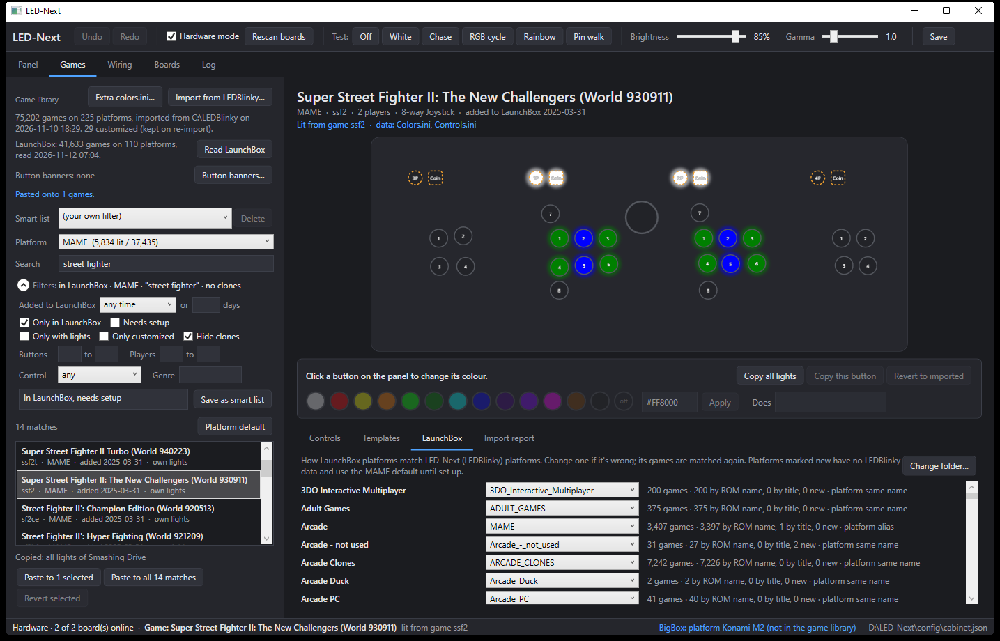
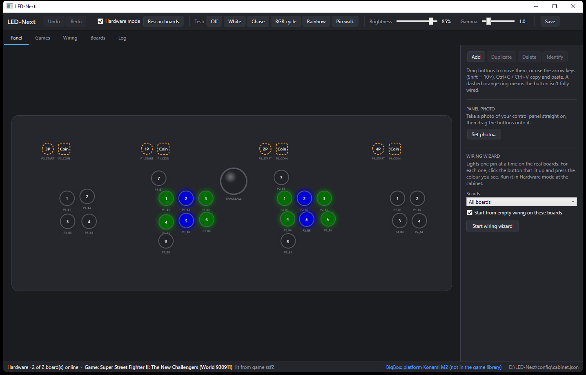
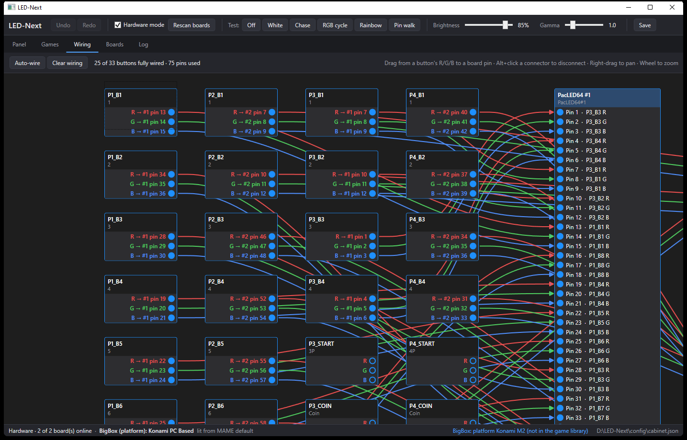
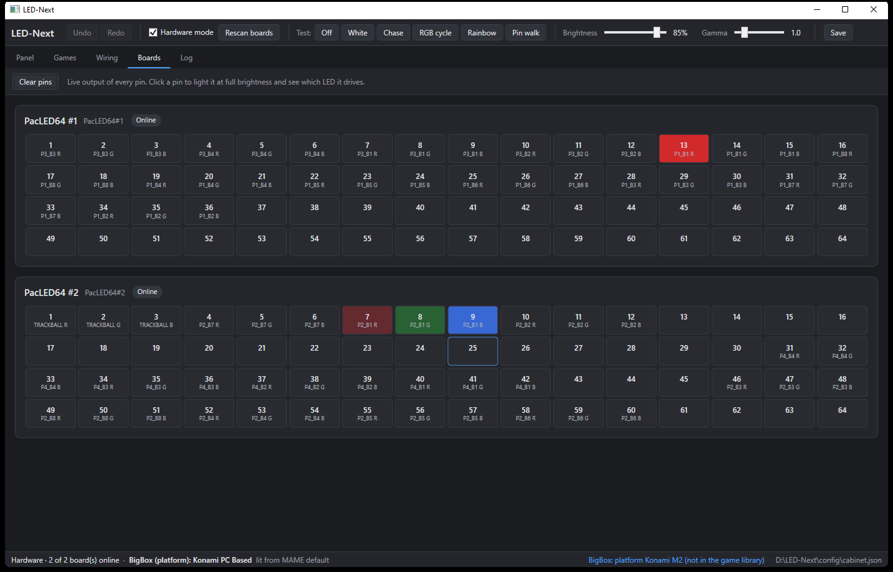

# LED-Next

A modern replacement for LEDBlinky: visual arcade panel layout, node-graph LED wiring,
multiple LED boards per PC, and per-game lighting for LaunchBox/BigBox.

> **Still in development.** LED-Next is used and tested on one real cabinet (4 players, two PacLED64 boards,
> LaunchBox/BigBox), but it is not finished: expect rough edges and changes, and check
> [`TASKS/00_ACTIVE_PRIORITIES.md`](TASKS/00_ACTIVE_PRIORITIES.md) for what is being worked on.

## Screenshots
**Games:** each game's lights are previewed on your panel (and on the real boards), and can be edited.


**Panel:** a visual designer for your control panel. The panel shows what the boards are lighting right now.


**Wiring:** drag each button's red, green and blue to board pins, or let the wiring wizard find them.


**Boards:** the live output of every pin on every board. Click a pin to find its LED.


## What LED-Next improves on LEDBlinky
LED-Next reads LEDBlinky's data, so your existing setup carries over, and then adds:
- **One app for everything.** Panel layout, wiring, game lights, testing and live lighting live in one window,
  not spread across separate configuration tools.
- **See your panel.** A visual panel designer (with your panel photo behind it) and a node-graph wiring editor,
  so you can see which button goes to which pin and colour.
- **A wiring wizard** that lights one pin at a time on the real boards: click the button that lit and the colour it
  showed, and the wiring is built for you.
- **Live preview.** Selecting a game lights it on screen and on the real panel at once, and every edit shows live.
- **Edit lights safely.** Your colour changes per game or per platform are stored apart from the imported data and
  are kept when you re-import LEDBlinky. One click reverts a game to its imported lights.
- **Light many games at once.** Templates, copy and paste of lights (all of them or one button) to selected games
  or to every match, and saved smart lists (platform, genre, button count, "6-button fighting games"…).
- **Lights follow your real key bindings:**
  - for **every MAME install** (each one's `ctrlr` file, `default.cfg` and per-game cfg), not just one;
  - for **TeknoParrot** games, from each game's own profile.

  So a racing or flight MAME build that remaps buttons lights the buttons the game really uses.
- **Knows your LaunchBox library.** It reads LaunchBox's games and platforms. Games that LEDBlinky has no data
  for still light from MAME's data or the platform default. You can filter for games recently added to LaunchBox
  or still needing setup. LaunchBox's control-panel pictures show beside each game.
- **Live BigBox lighting.** The plugin sends every selection, platform-wheel move, launch and exit straight
  to LED-Next. Each change is timed in the log, so slow spots are easy to find.
- **Live emulator lamps.** MAME's network output and Windows messages are both supported (for example, Start blinks
  while a game waits for a coin), and every output a game sends is logged.
- **Several boards, the same order every time.** Boards are found by their board id, not USB order, so unplugging
  one doesn't shuffle your wiring.
- **Works without hardware.** Simulator mode lets you set up and test everything away from the cabinet.
- **Stays out of the way.** It starts in the system tray with LaunchBox/BigBox, and installs to one exe plus your
  settings folder.
- **Read-only towards other tools.** LED-Next never writes to LEDBlinky's or LaunchBox's files. The only exception is
  its own plugin folder inside LaunchBox.

## What it supports
Tested on a 4-player cabinet with two Ultimarc PacLED64 boards, LaunchBox/BigBox 14.1 and LEDBlinky's data.

**LED controllers**
- Ultimarc **PacLED64** (RGB), several boards per PC, identified by board id rather than USB order.
- **Simulator** mode: everything works with no boards attached.
- Not supported yet: other Ultimarc boards (PacDrive, Ultimate I/O, I-PAC LED), LEDWiz, and other makers' boards.

**Panel and wiring**
- A visual panel designer: buttons, joysticks, trackball, coin and start, with a photo of your panel as a background.
- A node-graph wiring editor and a wiring wizard, which lights each pin in turn so you can find its button.
- A Boards view with a live grid for every pin, plus test patterns.

**Game lighting**
- Imports LEDBlinky's data (controls, colours and input map) and lights each game the way LEDBlinky would. It
  matched LEDBlinky on the real cabinet. It only reads LEDBlinky's files; it never changes them.
- Light inheritance: game → parent → platform → MAME default.
- Per-game and per-platform colour overrides, templates, bulk copy, and saved smart lists.
- **Each emulator's own key bindings.** When a game's buttons are remapped in the emulator, the lights follow:
  - **MAME:** each install's `ctrlr` file, `default.cfg` and per-game `cfg` (for cabinets with several MAME installs);
  - **TeknoParrot:** each game's user profile (DirectInput and RawInput keyboard bindings).

**Front ends**
- **LaunchBox / BigBox:**
  - LED-Next reads its game library; it only reads it and never changes it.
  - A plugin lights the panel as you browse games, platforms and the BigBox wheel, while a game plays, and when you exit.
  - The plugin starts LED-Next in the system tray.
- LaunchBox pictures ("Arcade - Control Panel", "Arcade - Controls Information") and button-layout banners in
  the Games tab.

**Live lamps from emulators**
- **MAME**, over network output (`output network`) or Windows messages (`output windows`). Lamps are mapped
  through LEDBlinky's `MameOutputs.ini`; for example, the Start lamp blinks while Galaga waits for a coin.
- **Flycast** network output: it can be read, but so far it has only been tested against a simulated Flycast.
- Not supported: Supermodel, and TeknoParrot's own output system.

**Not yet:** other front ends (only LaunchBox/BigBox), LEDBlinky animations (`.lwax`), BigBox playlists, and
lighting by front-end section.

**Needs:** Windows 10 or 11, the .NET 8 Desktop Runtime (or the self-contained build), and, for PacLED64 boards,
Ultimarc's `PacDrive64.dll`, which you supply yourself.

## Install
**From a release** (no build tools needed): download from the
[Releases page](https://github.com/QROACHATHOME/LED-Next/releases):
- **`LED-Next-x.y.z-win-x64.zip`** (small, needs the
  [.NET 8 Desktop Runtime](https://dotnet.microsoft.com/download/dotnet/8.0), x64), **or**
  `LED-Next-x.y.z-win-x64-self-contained.zip` (bigger, needs nothing else);
- for LaunchBox/BigBox, also **`LED-Next-LaunchBox-plugin-x.y.z.zip`**.

Unzip the LED-Next zip, unzip the plugin zip into the same folder, and close LED-Next, LaunchBox and BigBox.
Then double-click **`Install LED-Next.cmd`**.

**From the source code:** the same `Install LED-Next.cmd` in the repository builds LED-Next first (needs the
.NET 8 SDK). It builds the plugin against your LaunchBox too (needs the .NET 10 SDK).

Either way, LED-Next is installed to `D:\LED-Next` (or `C:\LED-Next` with no D: drive). The installer also
adds a Start menu shortcut and installs the LaunchBox/BigBox plugin, pointed at the installed exe. The installed
folder holds only:

```
LED-Next.exe      the whole app in one file
PacDrive64.dll    Ultimarc's SDK DLL (copied from your current setup; not shipped with LED-Next)
config\           cabinet.json, games.db, window.json (your settings; never overwritten)
logs\             led-next.log
```

Run it again to update: `config\` is kept, and leftovers of an older multi-file install are removed. On the
first install, settings are copied from the repo's Debug build folder; that folder is left untouched.
Options (pass them to the `.cmd` or to `tools\install.ps1`):
- `-InstallDir E:\LED-Next`, `-LaunchBox E:\LaunchBox`
- `-From <old folder>`: where to copy the settings from
- `-NoPlugin`, `-NoShortcut`
- `-SelfContained` (source code only): a bigger exe that needs no .NET on that PC
- `-Uninstall`: keeps `config\`; add `-RemoveSettings` to delete it too.

## Making a release
1. Set `<Version>` in `Directory.Build.props`, commit, then tag and push: `git tag v0.2.0` and
   `git push origin main v0.2.0`. GitHub Actions (`.github/workflows/release.yml`) tests, runs
   `build\Build-Release.ps1` and publishes both LED-Next zips.
2. On a PC with LaunchBox, at that commit, run `tools\build-plugin-release.ps1`. It builds the plugin against
   LaunchBox's own DLL. Then attach `dist\LED-Next-LaunchBox-plugin-x.y.z.zip` to the release (Edit release,
   then drag the zip in). GitHub can't build the plugin, because LaunchBox's DLL isn't ours to upload.

## Build and run (development)
```
dotnet build LedNext.sln
dotnet run --project src/LedNext.App
dotnet test
```

The app starts in **Simulator** mode, so it works without boards attached. Switch to
**Hardware** mode on the cabinet. See `TASKS/00_ACTIVE_PRIORITIES.md` for hardware setup.

Config is stored in `config/cabinet.json` next to the exe; logs in `logs/led-next.log`.
